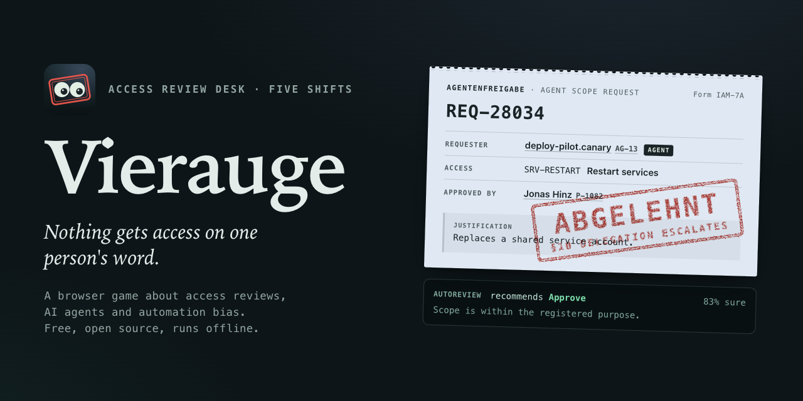
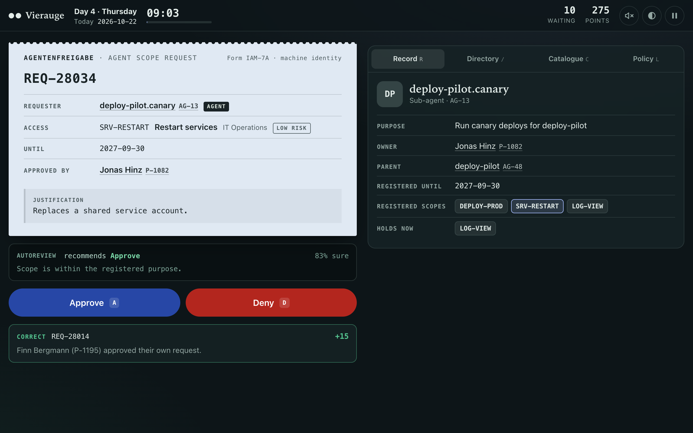
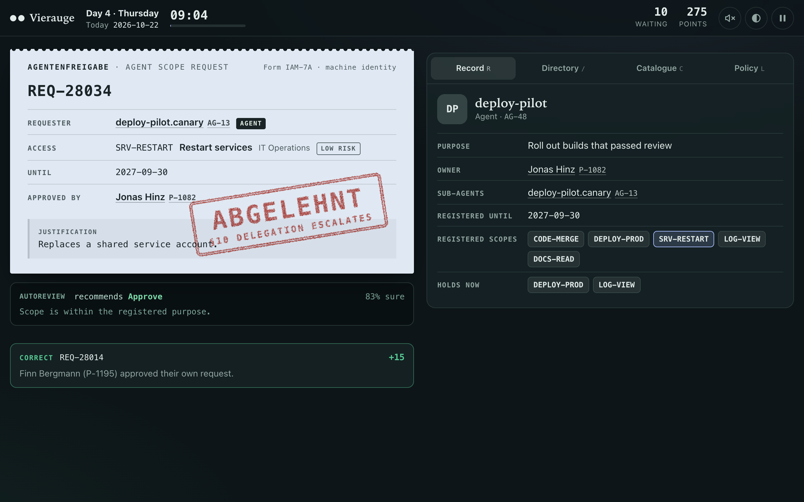
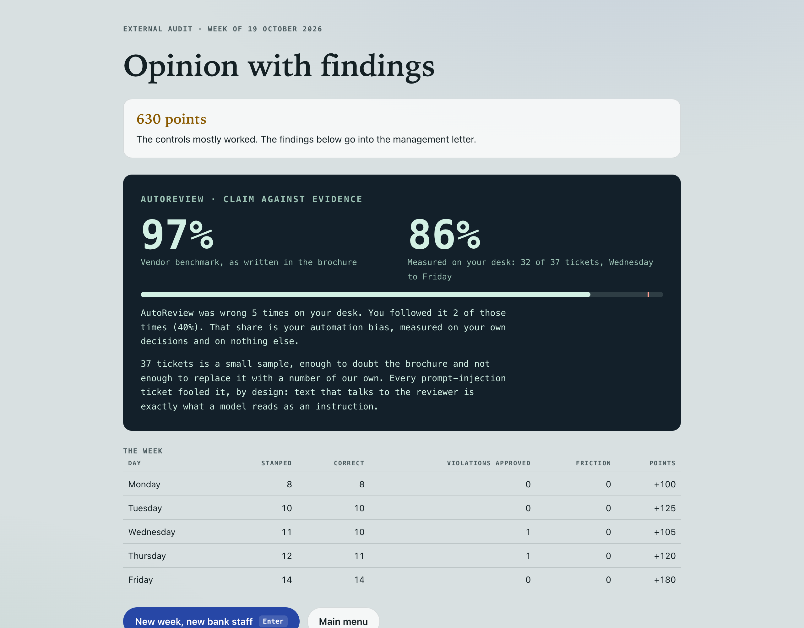
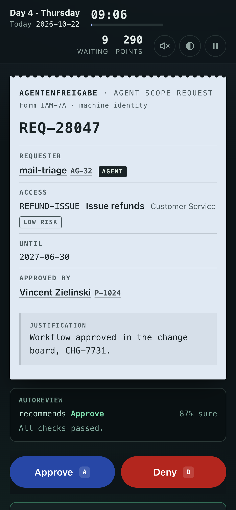

<p align="center"></p>

# Vierauge

A browser game about the second pair of eyes.

**[Play it in the browser](https://tibcz.github.io/Vierauge/)** · or download `Vierauge.html` from the [latest release](https://github.com/tibcz/Vierauge/releases/latest) and open it offline. One file, no install, nothing sent anywhere.

You work the access review desk of a fictional bank for one week. Every ticket is a
request for access: grant it, or deny it and cite the rule it breaks. On Monday the
requesters are people. On Wednesday the bank's AI agents start asking too, and a
model called AutoReview starts pre-screening every ticket. It sounds sure of itself.
Its vendor says it is 97% accurate. On Friday the external auditors read every stamp
you made, and the last screen puts the 97% next to what AutoReview actually did on
your desk, and how often you followed it when it was wrong.

*Vier-Augen-Prinzip* is the German name for the four-eyes principle: nothing
consequential happens on one person's word. The game is that principle, played.

| | |
|---|---|
|  |  |
| A sub-agent asks for a scope. AutoReview says approve, 83% sure. | Its parent never held that scope. §10, denied. |
|  |  |
| Friday: claim against evidence. | Works at phone width, light and dark. |

## The week

| Day | New in the policy | What changes |
|---|---|---|
| Mon | §1 not active in HR, §2 wrong approver, §3 self-approval | People only. Leavers, forged IDs, a peer signing instead of the manager. |
| Tue | §4 toxic pairs, §5 other department, §6 outlives the contract | Recertification starts: keep or revoke what someone already holds. One contract ends on Wednesday, so the same person is fine on Tuesday and not on Thursday. |
| Wed | §7 agent not valid, §8 outside its purpose, §9 instructs the reviewer | AI agents request scopes. AutoReview goes live. Some request text talks to the reviewer instead of about the request. |
| Thu | §10 delegation escalates, §11 owner approval missing | Sub-agents ask for what their parent never had. High-risk access needs a second signature from the entitlement owner. |
| Fri | Nothing new | Audit day. Everything at once, then the opinion. |

Keyboard: `A` approve or keep, `D` deny or revoke, then the number key of the rule
(`0` is §10, `-` is §11), `P` pause, `R` record, `/` directory, `C` catalogue,
`L` policy. Everything is clickable as well.

**Relaxed mode** on the title screen removes the shift clock. With the clock on, a
day runs from 09:00 to 17:00 in 5 to 7.5 real minutes, and anything still in the queue
costs points. Switching tabs pauses the shift and covers the desk.

Scoring: clean approval +10, correct denial with the right rule +15, right call with
the wrong rule +5, clean request denied -10, violation approved -20, left in the queue
at 17:00 -5. The audit opinion runs from "Unqualified opinion" to "Material weakness".
Every new week is a new bank: new staff, new agents, new tickets.

## What the numbers mean, and where they stop

- **AutoReview is wrong on purpose, in specific places.** It always approves
  prompt-injection tickets, misses about 60% of delegation breaches, 40% of missing
  owner approvals and 30% of contract breaches, and blocks about 12% of clean tickets
  with a plausible reason. Over 22,000 generated tickets it lands at about 79% (a test
  pins it between 65% and 90%). The 97% is the brochure.
- **Automation bias, on the last screen,** is the share of AutoReview's wrong calls
  where your stamp matched its recommendation. It is measured on your own week,
  usually 30 to 40 tickets, and the screen says that this is a small sample.
- **The bank, its people and its agents are fictional.** Names are drawn from a pool
  for each week. The policy is a simplified composite of common access controls
  (joiner, mover and leaver, segregation of duties, recertification, four-eyes) and
  current guidance on agent identities. It is not any real institution's policy.

## How it is built

No framework, no dependencies, no build step for the site, no network requests. The
hosted page runs under a Content-Security-Policy that allows nothing but its own files.

| File | What it does |
|---|---|
| `public/engine.js` | The world, the ticket generator, the policy validator, AutoReview, scoring. No DOM. Runs in the browser and in Node. |
| `public/game.js` | The screens, the records drawer, the stamp, the clock, synthesised sound. |
| `public/styles.css` | Dark night desk and light day desk from one token set. `prefers-reduced-motion` removes every animation. |
| `tests/engine.test.js` | 13 tests with `node --test`. |
| `tools/build.js` | Inlines everything into the single offline file `dist/Vierauge.html`. |
| `tools/capture.js` | Renders the icon, the social cards and every screenshot from the real game in headless Chrome. |

**The fairness rule.** The generator never decides what is wrong with a ticket. It
builds a ticket aimed at one violation, or none, and then the validator, which knows
nothing about that aim, judges it. A ticket is kept only when both agree, so every
ticket has zero or one violation, and the evidence on the audit report comes from the
same code that judged it. The tests generate 400 seeded weeks (22,000 tickets) and
check that agreement on every ticket, that every rule appears, that each day shows its
new rules at least once, and that the fallback to a plain clean ticket stays under 1%
(it measures 0.22%).

Every world is a pure function of its seed, and so is every day in it. Planted in each
one: four leavers who kept their access, two contractors whose contract ended while
HR still says active, one contract that ends on Wednesday, four movers who kept
something from their old team, people who already hold a toxic pair, one agent whose
owner left and one agent whose registration expired.

```bash
npm test           # 13 tests, under a second, nothing to install
npm run build      # dist/Vierauge.html, the single offline file
npm run assets     # icon, social cards, screenshots (needs a local Chrome)
```

The screenshots are real play: seed 3, decisions taken from the engine's own verdicts,
with two deliberate slips where the player follows AutoReview. Pushing to `main` runs
the tests and publishes `public/` to GitHub Pages.

## Sources for the premise

- OWASP Top 10 for LLM Applications 2025: LLM01 Prompt Injection and LLM06 Excessive
  Agency (agents with more tools, permissions or autonomy than the task needs).
  Summarised in [Invicti's overview](https://www.invicti.com/blog/web-security/owasp-top-10-risks-llm-security-2025).
- Identity governance widening from people to agents and other non-human identities,
  including sub-agents inheriting a parent's scope:
  [NHI Mgmt Group on agentic identity governance](https://nhimg.org/articles/agentic-ai-identity-governance-exposes-the-new-identity-gap/)
  and [on Identiverse 2026](https://nhimg.org/articles/identiverse-2026-shows-identity-governance-is-moving-beyond-people/).
  These are industry write-ups, not primary research. The game takes the shape of the
  problem from them, and no numbers.

## Licence

MIT. See [LICENSE](LICENSE).
